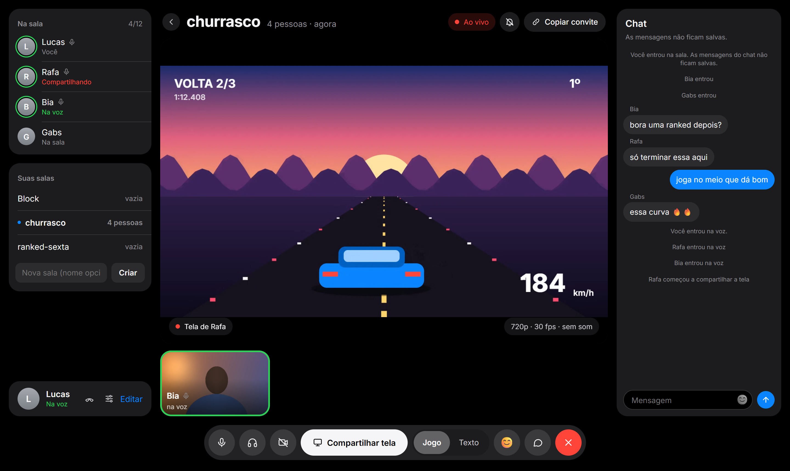

  <picture>
    <source media="(prefers-color-scheme: light)" srcset="assets/logo-light.svg">
    
  </picture>

<h1 align="center">CPX Call</h1>

<strong>Compartilhe a tela com a galera, leve e sem conta.</strong> Tela, voz, câmera e chat no navegador ou no app para Windows.

  <a href="https://github.com/melanolachef/call-app/releases/latest/download/CPX-Call-Windows.exe"><strong>Baixar para Windows</strong></a> ·
  <a href="https://cpx-call.fly.dev">Abrir no navegador</a> ·
  <a href="docs/ARQUITETURA.md">Como funciona</a> ·
  <a href="CONTRIBUTING.md">Contribuir</a>

  
  
  
  
  

O CPX Call é para jogar junto: você abre uma sala, manda o link e cada um pode
compartilhar a própria tela, entrar na voz, ligar a câmera e conversar no chat.
O vídeo vai **direto de um computador para o outro** (WebRTC), e o servidor, em
Rust, só apresenta as pessoas: **não guarda nada**, nem conta, nem mensagem, nem
registro de quem entrou.

[Recursos](#tudo-o-que-a-sala-tem) · [Como usar](#como-usar) · [Leve para quem joga](#leve-para-quem-joga) · [Privacidade](#o-servidor-não-guarda-nada) · [Documentação](#documentação)

## Tudo o que a sala tem

| Recurso | O que dá para fazer |
|---|---|
| **Compartilhar tela** | Cada pessoa compartilha a própria tela, com o **som** do jogo ou da aba. Um botão escolhe a **qualidade**: resolução (480p a 1440p), FPS (15, 30 ou 60) e se, quando faltar fôlego, mantém a fluidez (jogos) ou a nitidez (texto), com atalhos Jogo, Jogo liso e Texto. Quem assiste vê em tela cheia ou numa janela flutuante por cima do jogo. |
| **Voz** | Canal de voz como no Discord, com supressão de ruído, anel verde em quem fala, **apertar para falar** e **Ctrl+Shift+M** para mutar. |
| **Câmera** | Câmera leve no card de cada pessoa, enviada só para quem está vendo o card. |
| **Chat** | Mensagens em balões, emojis e reações que flutuam pela tela. Nada fica salvo. |
| **Block e salas** | Seu **Block** é uma sala fixa com link que nunca muda; as salas por onde você passa ficam na lista, com quem está em cada uma agora. |
| **Amigos** | Troque **códigos de amigo** (sem conta) e veja em que call cada um está agora, com um clique para entrar. Dá para ficar **invisível**. |
| **Do seu jeito** | Nick, foto (ou um GIF animado), banner, cor de destaque, tema e fundo, tudo salvo só no seu navegador. |
| **App para Windows** | A mesma sala numa janela própria, com a tecla de falar e o Ctrl+Shift+M funcionando **com o jogo em foco**. |

## Como usar

| Onde | Como |
|---|---|
| **Navegador** | Abra **[cpx-call.fly.dev](https://cpx-call.fly.dev)**, escolha um nick e crie uma sala. Chrome, Edge e Firefox no computador; no celular dá para assistir, falar e conversar. |
| **Windows** | Baixe o **[instalador](https://github.com/melanolachef/call-app/releases/latest/download/CPX-Call-Windows.exe)** (2 MB). O Windows pode avisar que o app não é reconhecido enquanto ele ganha reputação: **Mais informações › Executar assim mesmo**. |
| **Seu próprio servidor** | Um binário só, sem banco de dados. Veja [Hospedar](docs/HOSPEDAR.md) para rodar no seu PC ou no Fly.io. |
| **Do código** | `cargo run --release` e abra http://localhost:3000. Detalhes no [CONTRIBUTING.md](CONTRIBUTING.md). |

## Leve para quem joga

Quem compartilha a tela está jogando ao mesmo tempo, então o CPX Call evita
qualquer trabalho que não precisa fazer:

- **Só envia para quem assiste.** A tela só é codificada para quem clicou em
  Assistir, e a câmera só para quem está vendo o seu card.
- **Usa a placa de vídeo.** Quando o PC codifica H.264 em hardware (NVENC, AMF,
  QuickSync), é ele que vai; senão, VP8.
- **Desce sozinho quando aperta.** Se o encoder avisar que a CPU está no limite,
  a transmissão baixa de 30 para 24 FPS e depois a resolução, e volta quando alivia.
- **Imagem nítida desde o primeiro segundo**, sem abrir borrada e melhorar devagar.

## O servidor não guarda nada

O servidor só repassa a conversa inicial entre os navegadores (sinalização
WebRTC) e as mensagens do chat, sem gravar. As salas existem só na memória e
somem quando a última pessoa sai. Para os amigos verem em que call você está, o
servidor sabe em que sala o seu código de amigo está só enquanto você está nela
(e nada se você ficar invisível). Nick, foto, salas, amigos e aparência ficam no seu
navegador. Os logs mostram só o número do participante e o começo do código da
sala, nunca IP. Até a fonte vem do próprio servidor, para abrir o app não avisar
terceiros de quem está online.

## Documentação

| Você quer… | Leia |
|---|---|
| Entender a arquitetura e as decisões técnicas | [docs/ARQUITETURA.md](docs/ARQUITETURA.md) |
| Rodar o seu servidor (local, rede, Fly.io, TURN) | [docs/HOSPEDAR.md](docs/HOSPEDAR.md) |
| Desenvolver ou publicar o app para Windows | [docs/APP-WINDOWS.md](docs/APP-WINDOWS.md) |
| Ver o design das telas | [docs/design/cpx-call-componentes.html](docs/design/cpx-call-componentes.html) (componentes e sala, atual) e [docs/design/cpx-call-design.html](docs/design/cpx-call-design.html) (início e celular, versão anterior); abra no navegador |
| Contribuir com código | [CONTRIBUTING.md](CONTRIBUTING.md) |
| Reportar uma falha de segurança | [SECURITY.md](SECURITY.md) |

## Licença

[MIT](LICENSE). A fonte Inter segue a [SIL Open Font License](static/fonts/OFL.txt).
O app para Windows é assinado conforme a [política de assinatura](CODE_SIGNING_POLICY.md).
