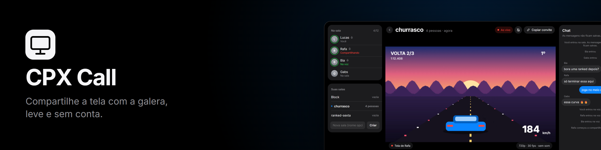

# CPX Call



Compartilhamento de tela entre amigos. Você abre o link, manda para a galera e cada um pode compartilhar a própria tela, com um chat de texto da sala. Não tem câmera nem conta.

- Servidor em Rust (axum + tokio) que só retransmite a sinalização WebRTC por WebSocket.
- O vídeo vai direto de navegador para navegador (P2P, mesh), com STUN público do Google.
- Cada pessoa escolhe um nick e, se quiser, uma foto (reduzida para 128×128 no próprio navegador). Os dois ficam salvos só no navegador e vão para os outros pelo canal de sinalização; o servidor não registra nada.
- Chat da sala pelo mesmo WebSocket da sinalização, para funcionar mesmo quando a conexão direta de vídeo falha. O servidor só repassa as mensagens: não grava nem registra nada, e quem entra depois não vê as anteriores.
- Até 12 pessoas por sala (configurável). As salas ficam só na memória e somem quando a última pessoa sai.

## Rodar

Precisa do Rust ([rustup.rs](https://rustup.rs)).

```sh
cargo run --release
```

Abra http://localhost:3000. Você cai no **lobby**: escolha seu nick, crie uma sala (com nome opcional) ou entre com um convite. As salas por onde você passa ficam em "Suas salas", com quantas pessoas estão em cada uma agora. Você também tem o seu **Block**, uma sala fixa: criada na primeira visita e guardada no navegador, ela é sempre a primeira da lista e não some (o link dela nunca muda, então os amigos sempre sabem onde te achar). Dentro de qualquer sala, o painel "Suas salas" na lateral mostra o Block e as salas salvas, com quem está em cada uma, para trocar de sala ou criar outra sem voltar ao lobby. Tudo isso fica só no navegador; o servidor não guarda nada. Dentro da sala, "Convidar" copia uma mensagem pronta com o link (no celular, abre o compartilhamento do sistema). Variáveis opcionais: `PORT` (padrão 3000) e `MAX_PEERS` (pessoas por sala, padrão 12), por exemplo `PORT=8080 MAX_PEERS=20 cargo run --release`.


## App para Windows

O lobby mostra **Baixar app para Windows** (só no Windows). O app abre a mesma sala do site numa janela própria e faz o que o navegador não consegue: a **tecla de falar** e o **Ctrl+Shift+M** funcionam com o jogo em primeiro plano. Ele só observa essas duas teclas (o jogo continua recebendo) e não lê nenhuma outra. Como o app carrega o site, toda mudança na página chega sem atualizar o app.

Fica em [desktop/](desktop/), em Rust com [Tauri 2](https://tauri.app) (usa o WebView2 que já vem no Windows, então o instalador tem poucos MB). Para rodar apontando para o servidor local:

```sh
cargo run --release                         # o servidor, em outro terminal
cd desktop
CPX_URL=http://localhost:3000 cargo run     # PowerShell: $env:CPX_URL="http://localhost:3000"; cargo run
```

Para gerar o instalador: `cargo install tauri-cli --version "^2" --locked` e `cargo tauri build` dentro de `desktop/`. Para publicar, crie uma tag `app-vX.Y.Z`: o workflow [app-windows.yml](.github/workflows/app-windows.yml) compila e cria o release com `CPX-Call-Windows.exe`, que é para onde o botão do lobby aponta. O app ainda não é assinado, então o Windows avisa na primeira vez ("Mais informações" › "Executar assim mesmo").

## Testar

**Dois navegadores (mesmo computador):** abra http://localhost:3000, crie uma sala, clique em "Convidar" e abra o link em outro navegador ou numa janela anônima (duas abas do mesmo navegador não entram na mesma sala). Clique em "Compartilhar tela" numa delas e a tela aparece na outra. Dica: compartilhe uma *outra* janela ou aba para não criar o efeito de espelho infinito. Dê um duplo clique no vídeo para ver em tela cheia.

**Dois computadores:** o servidor escuta em `0.0.0.0`, então na mesma rede dá para abrir `http://<IP-do-servidor>:3000/room/<id>`. Mas atenção: **os navegadores só liberam o compartilhamento de tela em HTTPS ou `localhost`**. Por HTTP pela rede, a pessoa consegue *assistir*, mas não *compartilhar*. Opções:

- Túnel HTTPS (mais fácil, funciona também pela internet): `cloudflared tunnel --url http://localhost:3000` (ou ngrok). Use o link `https://…` que ele mostrar.
- Só para teste na rede local, no Chrome: em `chrome://flags/#unsafely-treat-insecure-origin-as-secure`, adicione `http://<IP>:3000` e reinicie o navegador.

## Colocar no ar (Fly.io)

O projeto já vem com `Dockerfile` e `fly.toml` (região São Paulo, uma máquina sempre ligada, porque as salas ficam em memória). O Fly.io dá um endereço `https://<nome>.fly.dev` com HTTPS, então não precisa de domínio para começar.

```sh
fly auth signup                      # ou: fly auth login
fly apps create <nome-unico>         # e troque `app = "..."` no fly.toml por esse nome
fly deploy
```

Depois é só abrir `https://<nome-unico>.fly.dev`.

**TURN (recomendado):** sem ele, quem está em VPN, 4G ou rede de empresa pode não conseguir conectar. Crie uma chave em Cloudflare › Realtime › TURN Server (1.000 GB/mês grátis) e configure:

```sh
fly secrets set TURN_KEY_ID=<id da chave> TURN_KEY_API_TOKEN=<token da chave>
```

O servidor gera credenciais temporárias (24 h) pela API da Cloudflare e as entrega em `GET /api/ice`; a chave nunca vai para o navegador. Rodando localmente, as mesmas variáveis funcionam (veja `.env.example`). Para mudar o limite de pessoas: `fly secrets set MAX_PEERS=20` (ou edite `[env]` no `fly.toml`). Logs: `fly logs`.

## Desenvolvimento

O script da sala fica dividido por assunto em `static/room/` (estado, sessão/sinalização, WebRTC, compartilhar, voz, chat, lateral, interface, início). O servidor junta os arquivos, na ordem de `ROOM_JS` em `src/main.rs`, e entrega tudo como um único `/room.js`; os arquivos compartilham o mesmo escopo, como antes. Arquivo novo precisa entrar nessa lista.

```sh
cargo fmt                                  # formata
cargo clippy --all-targets -- -D warnings  # lints (deve passar sem avisos)
cargo test                                 # testes das salas e da sinalização via WebSocket
```

Código: [src/main.rs](src/main.rs) (rotas e páginas), [src/rooms.rs](src/rooms.rs) (salas em memória) e [src/signaling.rs](src/signaling.rs) (WebSocket).

## Limitações

- TURN é opcional: sem `TURN_KEY_ID`/`TURN_KEY_API_TOKEN`, o app usa só STUN, e em algumas redes (NAT simétrico, VPN, redes corporativas, alguns 4G) a conexão direta falha; o card mostra "Não foi possível conectar" com "Tentar de novo".
- Mesh: quem compartilha envia uma cópia do vídeo para cada pessoa *que está assistindo*. Com a sala cheia (12) isso dá até 11 envios, o que exige um bom upload; salas bem maiores pedem um servidor de mídia (SFU, issue #25).
- Se a conexão com o servidor cair, o app reconecta sozinho (1s, 2s, 4s… até 30s entre tentativas) e refaz as conexões; quem estava compartilhando continua, mas quem assistia precisa clicar em Assistir de novo.

## Decisões técnicas

- **HTML/JS embutidos no binário com `include_str!` em vez de `tower-http`**: uma dependência a menos e um binário único. A desvantagem é que qualquer mudança no HTML exige recompilar.
- **ID da sala gerado no navegador (`crypto.getRandomValues`)**: o servidor não precisa do crate `rand`.
- **Uma única transceiver de vídeo `sendrecv` por par, negociada uma vez só, por quem entra**: iniciar e parar o compartilhamento é só `replaceTrack()`, sem renegociação. Assim não há colisão de offers e o padrão "perfect negotiation" fica dispensável.
- **H.264 só quando ajuda**: cada navegador detecta se codifica H.264 na placa de vídeo (Media Capabilities, `powerEfficient`) e avisa os outros junto com o nick. Quem compartilha só usa H.264 se tiver encoder de hardware e quem assiste não for Firefox (que depende de um plugin que pode faltar); senão, VP8, que funciona em todo navegador.
- **Modo Jogo / Texto**: Jogo (padrão) prioriza fluidez, até 720p a 30 FPS com `contentHint = "motion"`; Texto prioriza nitidez, até 1080p a 15 FPS com `contentHint = "text"`. Os limites ficam no encoder (`scaleResolutionDownBy`, `maxFramerate`, `maxBitrate` de 2,5 Mbps), o que funciona com qualquer captura. No Jogo a imagem começa mais baixa e fica nítida em uns 15 s, conforme a estimativa de banda sobe.
- **Aparência**: cor de destaque (6 prontas ou qualquer uma; o texto dos botões fica branco ou escuro conforme o contraste), tema Escuro, AMOLED ou Meia-noite, e fundo em degradê ou imagem própria (reduzida no navegador). Só na sua tela e salva no navegador; aplicada no `<head>` para não piscar o visual padrão. Tudo estático, sem desfoque nem animação, para não custar nada a quem está jogando.
- **Call de voz**: "Entrar na voz" liga o microfone (com cancelamento de eco, supressão de ruído e ganho automático); só quem está na voz envia e ouve voz. Microfone (Ctrl+Shift+M), Fone (silencia todo mundo) e sair da voz; anel verde em quem está falando; configurações com escolha do microfone, medidor ao vivo e supressão de ruído. É uma terceira faixa por conexão, negociada uma vez, com custo desprezível para quem compartilha.
- **Ajuste automático (modo Jogo)**: se o encoder relatar que está limitado pela CPU por ~15 s (PC esquentando com o jogo), a transmissão desce um degrau (30 FPS → 24 FPS → 540p → 480p) e quem compartilha é avisado; depois de 2 minutos tranquilos, sobe de volta. Com 3 ou mais pessoas assistindo (uma codificação por pessoa no mesh), já começa em 24 FPS.
- **Câmera leve e sob demanda**: desligada por padrão; captura em 360p a 15 FPS e no máximo 400 kbps (240p, 12 FPS e 250 kbps enquanto a pessoa compartilha a tela). Cada um avisa se o card de quem está com câmera aparece na sua tela (aba visível e card à vista), e só então o vídeo é codificado para ele: quem está jogando com o navegador minimizado não custa nada. É a quarta faixa por conexão, negociada uma vez, ligada e desligada com `replaceTrack()`.
- **Imagem nítida desde o começo**: o vídeo começa com uma estimativa de banda de 1,5 Mbps (`x-google-start-bitrate`), em vez de abrir em 180p e levar uns 20 s para ficar nítido; se a conexão real for pior, a estimativa cai sozinha.
- **Som da transmissão**: o áudio vem junto com a tela quando o navegador permite. No Chrome/Edge do Windows, escolha "Tela inteira" e marque "Compartilhar áudio do sistema", ou uma aba com "Compartilhar áudio da guia"; janela sozinha ainda não leva som, e Firefox/Safari não capturam áudio. Sem tratamento de voz (que estraga música e jogo), com `restrictOwnAudio` para o som dos amigos não voltar em eco, e Opus em estéreo a 128 kbps. Quem assiste tem volume e silenciar no card.
- **Assistir sob demanda**: quem compartilha só envia o vídeo para quem clicou em "Assistir" (`replaceTrack` com a track para quem assiste e `null` para os outros). Assim ninguém codifica nem decodifica vídeo que não está sendo visto, o que pesa bastante para quem está jogando.
- **O aviso "compartilhando/parou" vai pelo próprio WebSocket** em vez de um DataChannel. O servidor repassa esse aviso sem ler o conteúdo, como faz com o resto.
- **`tokio::select!` num socket só, em vez de dividi-lo**: dispensa o crate `futures-util`.
- **Erros com `Result` e `?` (`Box<dyn Error>` no `main`) em vez de `anyhow`**: o servidor só tem dois pontos de falha, abrir a porta e ler `PORT`.
- **`ureq` para falar com a API da Cloudflare (TURN)**: um cliente HTTPS pequeno e síncrono, chamado numa thread separada, e só uma vez a cada 12 h (as credenciais ficam em cache).
- **`println!` em vez de `tracing`**: os logs mostram só o número do participante e os 6 primeiros caracteres da sala. Não registram IP nem o link completo.

## Contribuir

Contribuições são bem-vindas, sempre com revisão do mantenedor. Veja o [CONTRIBUTING.md](CONTRIBUTING.md).

## Licença

[MIT](LICENSE).
