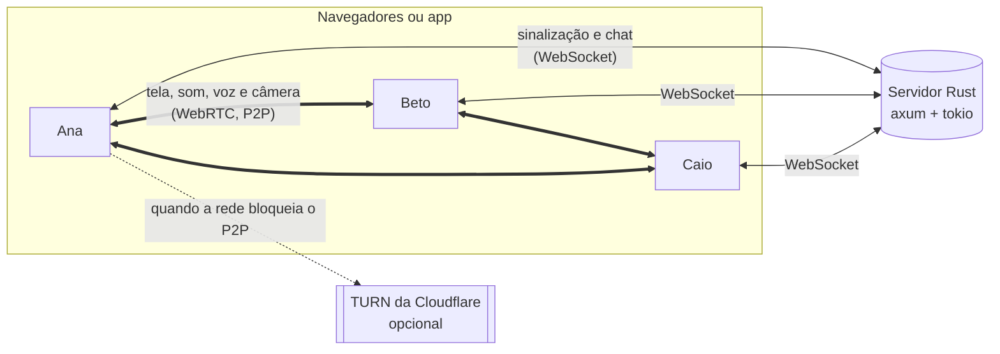

# Arquitetura

Como o CPX Call funciona por dentro e por que ele é assim. Para rodar, veja
[HOSPEDAR.md](HOSPEDAR.md); para mexer no código, o [CONTRIBUTING.md](../CONTRIBUTING.md).

## Visão geral

- **Servidor:** um binário Rust (axum + tokio) que entrega as páginas e
  repassa mensagens por WebSocket. Não lê o conteúdo nem guarda nada.
- **Mídia:** vai direto entre os participantes (WebRTC em *mesh*: cada par tem
  a sua conexão). STUN público do Google; com chave da Cloudflare, o servidor
  também entrega credenciais temporárias de TURN para quem não consegue
  conectar direto.
- **Estado:** salas só na memória (`HashMap` atrás de um `Mutex`), criadas na
  primeira entrada e apagadas quando a última pessoa sai. Até 12 pessoas por
  sala (`MAX_PEERS`).
- **Amigos (presença):** cada navegador guarda um segredo aleatório; o código de
  amigo é o SHA-256 dele (40 bits em base32, `XXXX-XXXX`). Na sala, a página
  manda `{"presence": {secret, nick}}` pelo WebSocket (ou `null` se invisível);
  o servidor recalcula o código e guarda "esse código está nesta sala" só em
  memória, enquanto a conexão existe. `GET /api/friends?codes=A,B` responde
  onde cada código está agora. Quem só conhece o código não consegue se passar
  pelo dono.

## Mapa do código

| Caminho | O que tem |
|---|---|
| [src/main.rs](../src/main.rs) | Rotas, páginas e arquivos embutidos no binário, `/api/rooms`, `/api/ice`, `/api/friends`, testes de ponta a ponta |
| [src/rooms.rs](../src/rooms.rs) | Salas em memória: entrar, sair, repassar, contar |
| [src/signaling.rs](../src/signaling.rs) | O WebSocket de cada participante, com ping a cada 25 s |
| [src/presence.rs](../src/presence.rs) | Amigos: código de amigo e quem está em que sala, só em memória |
| [src/ice.rs](../src/ice.rs) | Credenciais de TURN da Cloudflare, em cache por 12 h |
| [static/](../static/) | Páginas (`index.html` = início, `room.html` = sala), estilos e scripts comuns |
| [static/room/](../static/room/) | O script da sala, um arquivo por assunto (veja abaixo) |
| [desktop/](../desktop/) | O app para Windows (Tauri 2), veja [APP-WINDOWS.md](APP-WINDOWS.md) |
| [docs/design/](design/) | O design das telas (Claude Design) |

O script da sala fica dividido em `static/room/`: `estado`, `sessao`
(perfil e sinalização), `webrtc`, `compartilhar`, `voz`, `camera`, `ptt`
(apertar para falar e ponte com o app), `chat`, `emojis`, `notificacoes`,
`reacoes`, `lateral`, `interface` e `inicio`. O servidor junta os arquivos na
ordem de `ROOM_JS` em `src/main.rs` e entrega um único `/room.js`; eles
compartilham o mesmo escopo. **Arquivo novo precisa entrar nessa lista.**

## Protocolo

O cliente só manda uma coisa ao servidor: `{ "to": <id>, "data": <qualquer JSON> }`,
"entregue `data` ao participante `to`". O servidor responde com:

| Mensagem | Quando |
|---|---|
| `{"type":"welcome","id","peers","max"}` | Ao entrar: o seu número e quem já está na sala |
| `{"type":"peer-joined","id"}` / `{"type":"peer-left","id"}` | Alguém entrou ou saiu |
| `{"type":"signal","from","data"}` | Um `data` que outro participante mandou para você |
| `{"type":"full","max"}` | A sala está cheia |

Todo o resto vive dentro de `data` e só os navegadores entendem: perfil
(`nick`, `photo`, `hwH264`), SDP (`description`), candidatos ICE
(`candidate`), `sharing`, `watch`, `voice`, `camera`, `camWatch`, `chat`,
`reaction` e `restart`.

Quem entra por último manda a *offer*, então cada par negocia uma vez só, com
quatro faixas fixas: **tela**, **som da tela**, **voz** e **câmera**. Começar ou
parar qualquer uma é só `replaceTrack()`, sem renegociar.

## Decisões técnicas

- **Visual:** segue o design em [docs/design/cpx-call-componentes.html](design/cpx-call-componentes.html) (componentes e sala; o início e o celular seguem os mesmos tokens de `static/common.css`). As fontes Inter e JetBrains Mono vêm do próprio servidor (`/fonts/`), e não do Google Fonts, para abrir o app não avisar terceiros de quem está online.
- **HTML/JS embutidos no binário com `include_str!` em vez de `tower-http`:** uma dependência a menos e um binário único. A desvantagem é que qualquer mudança no HTML exige recompilar.
- **ID da sala gerado no navegador (`crypto.getRandomValues`):** o servidor não precisa do crate `rand`. Salas com nome ganham um final aleatório (`churrasco-k3f9x2`) para estranhos não adivinharem.
- **Faixas `sendrecv` negociadas uma vez, por quem entra:** iniciar e parar o compartilhamento é só `replaceTrack()`. Assim não há colisão de offers e o padrão "perfect negotiation" fica dispensável.
- **H.264 só quando ajuda:** cada navegador detecta se codifica H.264 na placa de vídeo (Media Capabilities, `powerEfficient`) e avisa os outros junto com o nick. Quem compartilha só usa H.264 se tiver encoder de hardware e quem assiste não for Firefox (que depende de um plugin que pode faltar); senão, VP8, que funciona em todo navegador.
- **Qualidade:** quem compartilha escolhe resolução (480p, 720p, 1080p, 1440p), FPS (15, 30, 60) e a prioridade: Fluidez (`contentHint = "motion"`, `maintain-framerate`) ou Nitidez (`"text"`, `maintain-resolution`). O padrão é 720p a 30 FPS com Fluidez. Os limites ficam no encoder (`scaleResolutionDownBy`, `maxFramerate`, `maxBitrate` ≈ 0,09 bit por pixel por quadro, entre 0,8 e 6 Mb/s; 720p30 ≈ 2,5 Mb/s), o que funciona com qualquer captura, e muda na hora durante a transmissão.
- **Ajuste automático:** se o encoder relatar que está limitado pela CPU por ~15 s (PC esquentando com o jogo), a transmissão desce um degrau a partir da escolha (Fluidez perde resolução primeiro, Nitidez perde quadros primeiro) e quem compartilha é avisado; depois de 2 minutos tranquilos, sobe de volta (no máximo duas descidas por transmissão). Com 3 ou mais pessoas assistindo, já começa um degrau abaixo.
- **Assistir sob demanda:** quem compartilha só envia o vídeo para quem clicou em "Assistir" (`replaceTrack` com a faixa para quem assiste e `null` para os outros). Ninguém codifica nem decodifica vídeo que não está sendo visto.
- **Imagem nítida desde o começo:** o vídeo começa com uma estimativa de banda de 1,5 Mbps (`x-google-start-bitrate`), em vez de abrir em 180p e levar uns 20 s para ficar nítido; se a conexão real for pior, a estimativa cai sozinha.
- **Som da transmissão:** o áudio vem junto com a tela quando o navegador permite (no Chrome/Edge do Windows, "Tela inteira" com "Compartilhar áudio do sistema", ou uma aba com "Compartilhar áudio da guia"). Sem tratamento de voz (que estraga música e jogo), com `restrictOwnAudio` para o som dos amigos não voltar em eco, e Opus em estéreo a 128 kbps.
- **Voz:** microfone com cancelamento de eco, supressão de ruído e ganho automático; só quem está na voz envia e ouve. Terceira faixa por conexão, com custo desprezível para quem compartilha.
- **Câmera leve e sob demanda:** 360p a 15 FPS e no máximo 400 kbps (240p, 12 FPS e 250 kbps enquanto a pessoa compartilha a tela). Cada um avisa (`camWatch`) se o card de quem está com câmera aparece na sua tela (aba visível e card à vista), e só então o vídeo é codificado para ele.
- **Aparência:** cor de destaque, tema (Escuro, Grafite ou Meia-noite) e fundo em degradê ou imagem própria. Só na sua tela, salva no navegador e aplicada no `<head>` para não piscar o visual padrão.
- **Avisos de estado pelo próprio WebSocket** (compartilhando, voz, câmera) em vez de um DataChannel. O servidor repassa sem ler, como faz com o resto.
- **`tokio::select!` num socket só, em vez de dividi-lo:** dispensa o crate `futures-util`.
- **Erros com `Result` e `?` (`Box<dyn Error>` no `main`) em vez de `anyhow`:** o servidor só tem dois pontos de falha, abrir a porta e ler `PORT`.
- **`ureq` para a API da Cloudflare (TURN):** um cliente HTTPS pequeno e síncrono, chamado numa thread separada, e só uma vez a cada 12 h.
- **`println!` em vez de `tracing`:** os logs mostram só o número do participante e os 6 primeiros caracteres da sala. Não registram IP nem o link completo.

## Limitações

- **GIFs:** a página busca em `GET /api/gifs` (o servidor repassa ao KLIPY, no formato da API do Tenor, com a chave `GIF_API_KEY` e um cache de 10 min em memória). O GIF escolhido vai pela sinalização como `{ gif: { url, w, h, title } }`; quem recebe só mostra URLs https dos domínios do KLIPY. A mesma busca serve para usar um GIF como **foto ou banner** (diálogo de perfil, em `common.js`): só a URL viaja, e `validPhoto`/`validBannerImage` aceitam, além de imagens inline, apenas URLs `https://…klipy…/….gif` com caracteres seguros dentro de `url("")`. O enquadramento escolhido no recorte vai no fim da URL (`#p=x,y,tamanho`, posição e largura do fundo em %), porque um GIF animado não dá para recortar sem refazê-lo. Fora do cartão e do diálogo de perfil, o GIF aparece parado: o primeiro quadro é desenhado num canvas (o CDN do KLIPY libera CORS) e só anima no hover.
- **TURN é opcional:** sem `TURN_KEY_ID`/`TURN_KEY_API_TOKEN`, só há STUN, e em algumas redes (NAT simétrico, VPN, redes corporativas, alguns 4G) a conexão direta falha; o card mostra "Não foi possível conectar" com "Tentar de novo".
- **Mesh:** quem compartilha envia uma cópia do vídeo para cada pessoa que assiste. Com a sala cheia (12), isso dá até 11 envios e exige um bom upload; salas bem maiores pedem um servidor de mídia (SFU, issue #25).
- **Reconexão:** se a conexão com o servidor cair, o app reconecta sozinho (1 s, 2 s, 4 s… até 30 s entre tentativas) e refaz as conexões; quem estava compartilhando continua, mas quem assistia precisa clicar em Assistir de novo.
- **Uma instância só:** como as salas ficam na memória, o servidor não escala horizontalmente. Para o tamanho de um grupo de amigos, uma máquina pequena basta.
